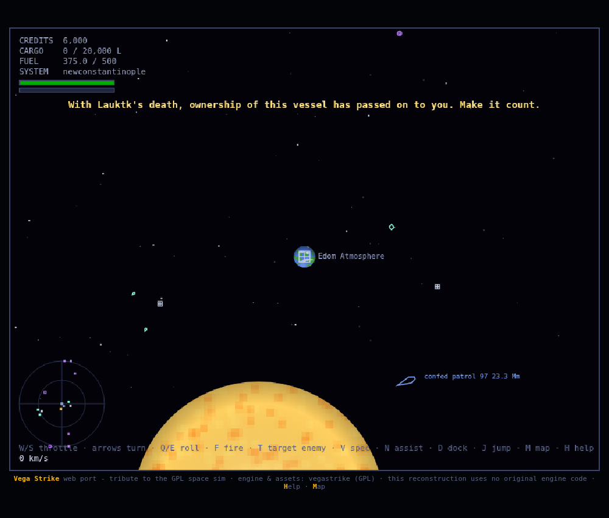
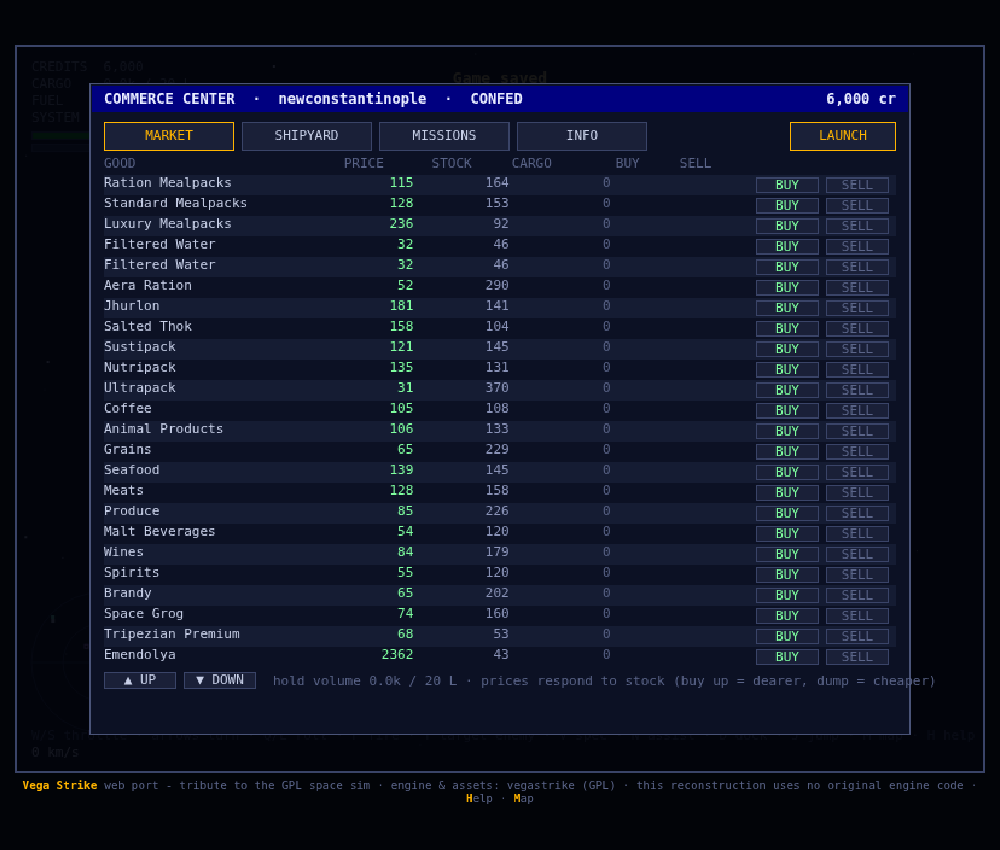
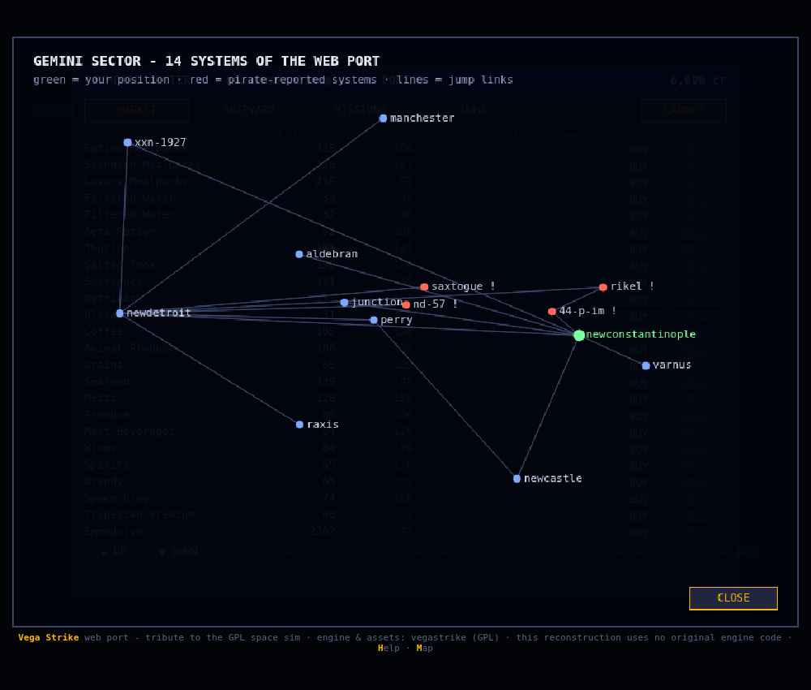

# Vega Strike — Web Port

A clean-room, single-file browser tribute to **Vega Strike**, the open-source
space simulation, combat and trading game started by Daniel Horn in 2001
(engine GPL-3.0-class, assets GPL-2.0, both maintained by the Vega Strike
Contributors at [github.com/vegastrike](https://github.com/vegastrike)).

Open `index.html`. One self-contained file (~134 KB), no dependencies, no
build step, no network requests — flight, trading, combat, upgrades, missions
and save games all run locally.

## Why this game

Vega Strike is fully open source — engine *and* assets — so unlike a
closed-source port, the game data itself is reusable. This port imports
authentic data straight from the project's repositories and rebuilds the core
Vega Strike loop in the browser: **fly, dock, trade, upgrade, fight, jump**.

## What is authentic (from the GPL repos)

All data below is derived from `vegastrike/Assets-Production` (GPL-2.0) and
`vegastrike/Vega-Strike-Engine-Source` (GPL) — see `src/data.js` header:

- **14 star systems of the Gemini sector** around the canonical start:
  New Constantinople, New Detroit, Perry, New Castle, XXN-1927, Varnus,
  Rikel, Manchester, ND-57, Saxtogue, Raxis, 44-P-IM, Junction, Aldebran —
  with their planets, radii, positions and **jump-point links** parsed from
  the real `.system` files.
- **203 trade goods** with base prices and volumes from
  `master_part_list.csv` — from Ration Mealpacks and Filtered Water to
  Space Grog, Tripezaan Premium and the Contraband category.
- **23 shipyard parts** with real names and prices (laser, Ion Burster,
  Micro/Mini Driver, Disruptor, Pugilist; dual shields 01–04; armor;
  reactors; overdrives; SPEC capacitors; cargo expansion).
- **Ship roster with units.csv stats**: Llama.begin (the ship you inherit —
  "With Lauktk's death, ownership of this vessel has passed on to you"),
  Llama, Dostoevsky, Quicksilver, Admonisher, Hidalgo, Mule — masses, fuel
  and hull values transcribed per-row.
- **Factions**: confed, merchant_guild, pirates, LIHW, ISO, rlaan, aera,
  hunter, and more, with faction-colored contacts.
- **Documented mechanics**: confed customs seize contraband at lawful
  stations; pirates hunt in the border systems; bounty work pays per kill.

## What is reconstructed (documented in code comments)

- The engine itself: this port shares **no original engine code**. Flight
  (assist / Newtonian toggle), the SPEC drive (×200), jump tunnels,
  projectile combat and NPC behaviors are new implementations.
- Station placement fill for systems whose `.system` files list few bases;
  jump-node positions spread on a ring (authentic files cluster them);
  per-base market variation and stock dynamics; mission board offers;
  procedural planet textures and synthesized sound (no original assets
  are redistributed).

## The loop

1. Dock at the Commerce Center (D, within 6 Mm, under 3 Mm/s).
2. Buy low at the market — prices respond to stock (dumping crashes them).
3. Fly or SPEC to another system through violet jump points (J).
4. Sell high; take cargo and bounty jobs from the mission board.
5. Spend credits in the shipyard: guns, shields, armor, overdrive, SPEC caps.
6. Pirates raid saxtogue, nd-57, rikel and 44-P-IM. F5 saves at stations.

### Controls

| Key | Action |
| --- | --- |
| W / S | throttle up / down · **Space** boost |
| Arrow keys, Q / E | pitch & yaw, roll |
| F / T | fire, cycle target |
| V / N | SPEC drive, flight assist toggle |
| D / J | dock, jump |
| M / H / F5 | galaxy map, help, save (stations) |

## Verification

`verify_game.py` (run before release) checks the design with the *same*
formulas the JS uses:

1. Jump graph: **14/14 systems reachable** from New Constantinople.
2. Markets: **40 stations**, every market stocked with all legal goods,
   prices positive.
3. Arbitrage: median best margin across 135 directed station pairs
   ≈ **72%**, spread present on 100% of links (combat and hold size are the
   real limits, as in the original).
4. First cargo run: **+4,085 cr** profit on 6,000 starting credits.
5. Combat: pirate kills in ~12 s; a passive player survives ~70 s.

`build_universe.py` / `extract_data.py` / `build.py` in `src/` reproduce the
data pipeline. During development the suite caught a genuine porting bug:
JavaScript's `& 0xFFFFFFFF` is a *sign-preserving int32 no-op*, unlike
Python's unsigned mask — the seeded PRNG diverged between the Python
prototype and the JS build (negative outputs → broken spawns) until both
sides were switched to the canonical `Math.imul` mulberry32 and verified
sequence-identical.

## Next-step investigation (2026-11-18)

The technical feasibility report on upgrading this port with the original GPL
engine (WebAssembly), original assets and original mechanics lives in
[`docs/feasibility-report.pdf`](docs/feasibility-report.pdf), with a summary in
[`docs/feasibility-report.md`](docs/feasibility-report.md). Verdict: a staged
plan — asset and mechanics authenticity now inside the existing JS game,
time-boxed WASM spikes with explicit go/no-go gates, and full engine bring-up
only on evidence. The current port remains the shipped product throughout.

## Sources

- Engine (GPL): https://github.com/vegastrike/Vega-Strike-Engine-Source
- Assets & data (GPL-2.0):
  https://github.com/vegastrike/Assets-Production
  — `units/units.csv`, `master_part_list.csv`, `factions.xml`,
  `sectors/testsystems/gemini_sector/*.system`, `.vegastrike/*/*.system`
- LICENSE in this repo is the engine's own GPL-3.0 LICENSE file (Vega Strike
  Contributors).

## License

This port: **GPL-3.0** — see LICENSE (the Vega Strike engine's license
header plus the full GNU GPL text). Derived data (goods, prices, ship stats,
system layouts) comes from the GPL-licensed Vega Strike asset repository and
is redistributed here under the same terms. "Vega Strike" and the original
game are the work of the Vega Strike Contributors; this is an unofficial
tribute.
